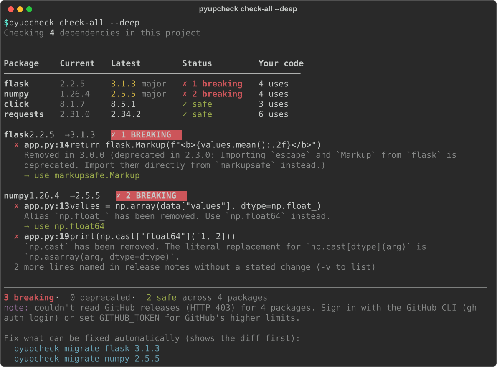
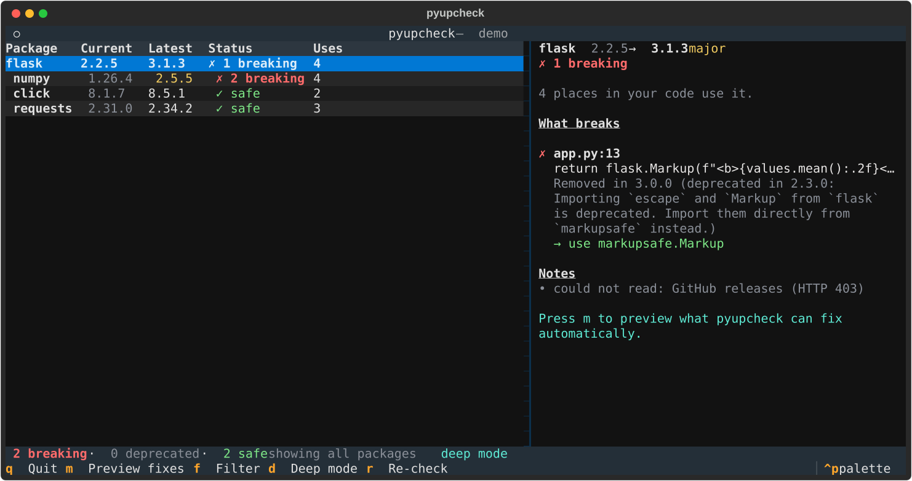
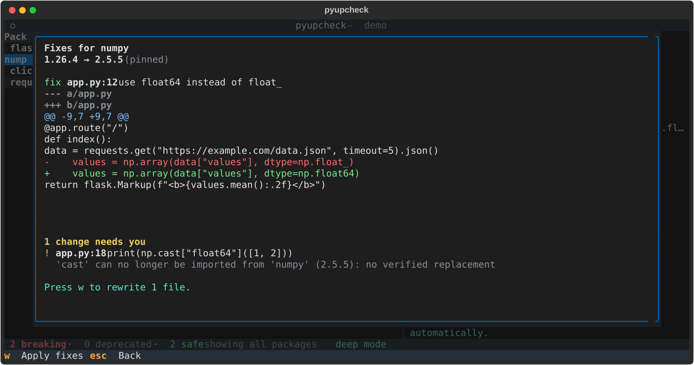
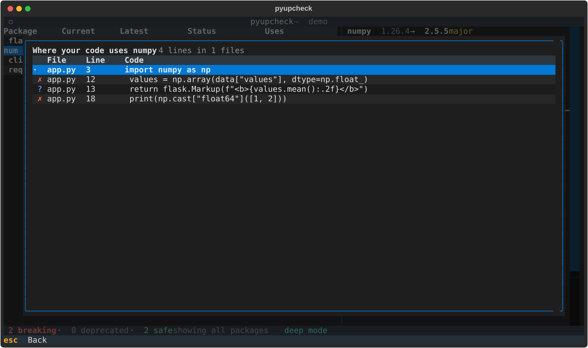

# pyupcheck

**Know what breaks before you upgrade.** pyupcheck reads your code and the real API of both versions of each dependency, shows you the exact lines an upgrade breaks, and rewrites the ones it safely can.

[](https://pypi.org/project/pyupcheck/)
[](https://pypi.org/project/pyupcheck/)
[](https://github.com/Astronomox/pyupcheck-Astronomox/actions/workflows/ci.yml)
[](LICENSE)

<p align="center"></p>

- **Accurate:** on 56 real upgrades (Django, Flask, NumPy, pandas, Pydantic, SQLAlchemy and more), deep mode catches **100%** of breaking lines with **no false alarms**. On a real 2018 Flask app upgraded to today's releases, it reports 15 breaking lines, each confirmed by running the new versions.
- **Fixes, not just warnings:** `pyupcheck migrate` rewrites moved names, renamed arguments and keyword-only calls, checked against the new version's real API.
- **Wide reach:** **96.7%** of the 1,000 most-downloaded PyPI packages can be deep-checked. It works with pip, uv, Poetry, PDM, Pipenv, conda and pixi, plus Jupyter notebooks.
- **Fits your workflow:** a GitHub Action that comments on dependency PRs, `watch` mode, and a VS Code extension.

Website: [pyupcheck.vercel.app](https://pyupcheck.vercel.app) · Changes: [CHANGELOG.md](CHANGELOG.md) · Latest: **0.21.0**

## Install

```bash
pip install pyupcheck
```

On Windows, `python -m pip install -U pyupcheck` upgrades it even when `pip.exe` can't replace itself. Then:

```bash
pyupcheck banner      # logo, your version, the latest release, where to start
pyupcheck check-all   # check every dependency in this project
```

`pyupcheck banner` runs full screen in an interactive terminal. The logo's colours flow, and the whole layout is redrawn for the window's width and height whenever you resize it: one-row logo, PYUP over CHECK, or a one-line wordmark. Any key exits and leaves a copy sized to the window. `--static` prints once; so do pipes, CI and `PYUPCHECK_NO_ANIMATION=1`.

## What the output looks like

`check-all` opens with one table of every package: current and latest version (with major upgrades marked), a status (`✗ 2 breaking`, `! 1 deprecated`, `? not checked`, `✓ safe`) and how many places your code uses it. What needs attention comes first, and packages already up to date are listed on one line underneath:

```
Package    Current   Latest        Status         Your code
flask      2.2.5     3.1.3 major   ✗ 1 breaking   4 uses
numpy      1.26.4    2.5.5 major   ✗ 2 breaking   4 uses
click      8.1.7     8.5.1         ✓ safe         2 uses
requests   2.31.0    2.34.2        ✓ safe         3 uses
✓ Already up to date (2): httpx, rich
```

Then each package that breaks or deprecates something gets its own section: every line with its file and line number (`verified` when deep mode confirmed it against the real code), the release note in plain text, and `→ use …` when there is a replacement. Lines that release notes only mention, without saying the API changed, are grouped by note under "worth a look"; low-confidence mentions are counted, and `-v` lists them. The run ends with one summary:

```
3 breaking · 1 deprecated · 2 safe across 4 packages

Fix what can be fixed automatically (shows the diff first):
  pyupcheck migrate flask 3.0.0
  pyupcheck migrate numpy 2.0.0
```

A source that couldn't be read (say, GitHub rate-limiting you) is mentioned once in that summary, with a hint, instead of under every package. Terminals that can't print Unicode get ASCII symbols, and `pyupcheck --help` (or `-h`) fits narrow windows.

## Commands

### `ui` - browse and fix upgrades, full screen

```bash
pip install "pyupcheck[ui]"
pyupcheck ui
```

<p align="center"></p>

Every dependency fills in its row as it is checked, with what needs attention first. Move through the table to see each package's breaking lines, release notes and replacements in the side panel. Press **m** to preview what `migrate` can rewrite: the diff, and what still needs a manual change. In the preview, **w** applies the fixes after you confirm, and the package is checked again.

<p align="center"></p>

The details also show **where your code uses the package**: the files with the most uses, and the first lines of each, with lines that break marked. Press **u** for the full list of every line, file by file.

<p align="center"></p>

Keys: **f** cycles the filter (all, needs attention, used by your code), **d** switches deep mode on or off, **r** re-checks, **v** shows low-confidence mentions, **q** quits. On a narrow window the table and the details stack.

### `check` - check one package

```bash
pyupcheck check flask 3.0.0        # against specific version
pyupcheck check flask              # against latest
```

### `check-all` - check every dependency

Reads every `requirements*.txt` (following `-r` includes), `pyproject.toml` (PEP 621, PEP 735 dependency groups, Poetry, PDM, uv), `Pipfile`, `setup.cfg`, `setup.py` and `environment.yml`, and checks every dependency against its latest version.

```bash
pyupcheck check-all
pyupcheck check-all --deep          # fact-based API diff for every dependency
pyupcheck check-all flask numpy     # only the packages you name
pyupcheck check-all -j 16           # check 16 dependencies in parallel (default 8)
pyupcheck check-all --format html -o report.html
```

If a lockfile is present (`uv.lock`, `poetry.lock`, `pdm.lock`, `pylock.toml`, `Pipfile.lock`, `conda-lock.yml`, `pixi.lock`), the locked versions are used as the starting point. In a uv workspace (`[tool.uv.workspace]`), every member's `pyproject.toml` counts too, with its own constraints. Packages your code imports that are only in the lockfile because another dependency pulls them in (`urllib3` via `requests`) are checked too and marked **undeclared**: their version can change without you upgrading anything.

Install names and import names don't have to match: `pyyaml` is scanned as `yaml`, `Pillow` as `PIL`, `scikit-learn` as `sklearn`, `protobuf` as `google.protobuf`. Names come from the installed package's metadata when available, then a built-in table of known mismatches.

### `migrate` - rewrite your code for an upgrade

```bash
pyupcheck migrate scipy 1.14.0          # show a diff of the fixes
pyupcheck migrate scipy 1.14.0 --write  # apply them
```

Applies only mechanical changes it can verify against the new version's real API:

- arguments that became keyword-only: `f(a, 1)` -> `f(a, b=1)`
- renamed keyword arguments: `Retry(method_whitelist=...)` -> `Retry(allowed_methods=...)`
- renamed or moved names: `integrate.simps` -> `integrate.simpson`, `np.float_` -> `np.float64`, `from django.utils.encoding import force_text` -> `... import force_str as force_text`
- names moved to another package: `from flask import Markup` -> `from markupsafe import Markup`, and `flask.Markup(...)` -> `markupsafe.Markup(...)` with `import markupsafe` added (checked against that package's real API)

Replacements come from the package's own deprecation notes (including ones published before your current version), are paired one-to-one ("`a`, `b` in favour of `x`, `y` respectively"), and are only applied if the replacement exists in the target version. Anything else that breaks (a new required argument, an API moved to another package) is listed for you to change by hand, and the command exits 1 while such items remain.

### `fix` - move pins to the highest safe version

```bash
pyupcheck fix --dry-run   # show what would change
pyupcheck fix             # rewrite the ==pins in your requirements files
```

Each `==x.y.z` pin moves to the newest release that breaks none of your code, checked in deep mode by default. If the latest release breaks you, the pin still moves as far as it safely can instead of staying put, and held-back packages are named. A version that couldn't be checked is never used.

### `review` - check a pull request's dependency changes

```bash
pyupcheck review --base origin/main
```

Finds every dependency whose resolved version changed since `--base` (dependency files and lockfiles, uncommitted changes included). It checks each one from its old version to its new one. Run in a terminal, it shows the same table and findings as `check-all`; piped, or with `-o`, it writes a Markdown report (`--format terminal` or `--format md` picks one). The [GitHub Action](#review-dependency-pull-requests) posts that report as a PR comment.

### `outdated` - list stale dependencies

```bash
pyupcheck outdated
```

Flags major version bumps separately since they carry the most risk.

```bash
pyupcheck outdated --safe
```

Adds a **Highest safe** column: the newest version that breaks none of your code. If the latest release breaks you (`scipy 1.18` removes `simps`), you still learn you can move to `1.13.1` today. `pyupcheck fix` moves each `==` pin to exactly that version.

### `watch` - re-check as your dependencies change

```bash
pyupcheck watch
```

Leave it running in a terminal while you work. When a version in your requirements files, `pyproject.toml` or lockfile changes (`pip-compile`, `uv lock`, `poetry update`, a merged Dependabot PR, an edit), it checks each package that moved, from its old version to its new one, and says what breaks and what `migrate` can fix:

```
10:24:10 requirements.txt changed: 1 version change(s)
flask 2.2.5 -> 3.0.0  1 BREAKING
  x app.py:3  x = flask.Markup("<b>")
    -> use markupsafe.Markup
    pyupcheck migrate flask 3.0.0 --write fixes 1 of these
```

Every hour (`--releases MINUTES`, `0` to turn off) it also asks PyPI for new releases your constraints allow, and tells you whether each one breaks your code before you upgrade. `--bell` rings the terminal bell when something breaks; `-q` prints only what breaks. A lockfile written in several steps is read once it stops changing, and a half-written one never replaces the last good state.

### `diff` - changelog diff between versions

See what the release notes say changed between any two versions, without scanning code: grouped by release, newest first, each change once, labelled removed, deprecated, renamed or changed.

```bash
pyupcheck diff django 4.2.0 5.0.0
```

### `explain` - ask Claude how to fix what breaks

For what `migrate` can't change by itself (no drop-in replacement, an argument whose meaning changed), `explain` sends each breaking usage to Claude with the release note behind it and the replacement pyupcheck verified, and streams back a before/after for each:

```bash
pip install "pyupcheck[ai]"
export ANTHROPIC_API_KEY=...      # or: ant auth login
pyupcheck explain numpy 2.0.0
pyupcheck explain numpy 2.0.0 --dry-run   # shows exactly what would be sent, sends nothing
```

Only the few lines around each breaking usage are sent (`--max` caps how many usages), and the command says how much before it sends anything. `--effort` trades speed for thoroughness. Check the advice before applying it: `pyupcheck check` verifies the result.

### `scan` - list your usages of a package

```bash
pyupcheck scan requests
```

Every line of your code that uses the package, file by file, with each name it uses and how (a call, an attribute, an import).

### `versions` - a package's releases

```bash
pyupcheck versions numpy
pyupcheck versions numpy --all
```

Releases newest first, with their dates. The latest release, the one your project is on (from its lockfile, pin or installed version), yanked releases and pre-releases are marked.

### `ci-setup` and `cache-clear`

```bash
pyupcheck ci-setup --type github     # or pre-commit, or all
pyupcheck cache-clear
```

## Editor: VS Code

`editors/vscode` is a VS Code extension: breaking usages show as errors on their lines (deprecations as warnings, notebook findings on their cell), a quick fix runs `pyupcheck migrate`, and it re-checks when a requirements file, `pyproject.toml` or lockfile is saved. CI builds it as a `.vsix` (the `pyupcheck-vscode` artifact): install it with `code --install-extension pyupcheck-vscode.vsix`. See [editors/vscode/README.md](editors/vscode/README.md).

## Output formats

```bash
pyupcheck check flask -f json          # machine-readable
pyupcheck check flask -f md -o r.md   # markdown report
pyupcheck check flask -f html -o r.html # styled HTML report
pyupcheck check-all -f sarif -o r.sarif # SARIF, for GitHub code scanning
pyupcheck check-all -f github           # GitHub Actions annotations
```

## Review dependency pull requests

Comment on every pull request that changes a dependency version (Dependabot, Renovate, or by hand) with the call sites each upgrade breaks and how many `pyupcheck migrate` can fix:

```yaml
# .github/workflows/dependency-review.yml
name: Dependency review
on:
  pull_request:
    paths: ["requirements*.txt", "pyproject.toml", "*.lock", "pylock*.toml", "Pipfile*"]
permissions:
  contents: read
  pull-requests: write
jobs:
  review:
    runs-on: ubuntu-latest
    steps:
      - uses: actions/checkout@v7
        with:
          fetch-depth: 0
      - uses: Astronomox/pyupcheck-Astronomox@v0.21.0
        # with:
        #   fail-on: breaking   # make the check fail on breaking usages
        #   deep: "false"       # changelog only (faster)
        #   sarif: pyupcheck.sarif  # then upload it for the Security tab:
      # - uses: github/codeql-action/upload-sarif@v3
      #   with:
      #     sarif_file: pyupcheck.sarif
```

Each finding is also annotated on its line in the PR diff (`annotations: "false"` to turn that off).

The comment is updated in place on later pushes, and the same report is written to the job summary, so it is still visible when the token can't comment (for example on pull requests from forks). Locally:

```bash
pyupcheck review --base origin/main
```

## CI integration

Exit code is 1 when the `--fail-on` condition is met:

```bash
pyupcheck check-all --fail-on breaking     # default
pyupcheck check-all --fail-on deprecated   # stricter
pyupcheck check-all --fail-on any          # strictest
pyupcheck check-all --fail-on never        # report only
```

GitHub Actions example:

```yaml
- name: Check dependency upgrades
  run: |
    pip install pyupcheck
    pyupcheck check-all --fail-on breaking --quiet
```

Pre-commit hook (`.pre-commit-config.yaml`):

```yaml
- repo: local
  hooks:
    - id: pyupcheck
      name: pyupcheck
      entry: pyupcheck check-all --quiet
      language: system
      pass_filenames: false
```

## Configuration

`pyproject.toml`:

```toml
[tool.pyupcheck]
exclude = ["migrations", "legacy"]
ignore = ["internal-package"]
fail_on = "breaking"
min_severity = "deprecated"
cache = true
```

A mistake in that table is reported, not silently ignored: an unknown key (`ignores = [...]`) or a value pyupcheck doesn't accept (`fail_on = "breakng"`) is named on stderr, with a suggestion when one is close, and the setting keeps its default.

Or `.pyupcheckignore`:

```
migrations/          # trailing slash = directory
legacy/
internal-package     # no slash = package to skip
```

## Deep mode

By default, pyupcheck detects breaking changes by parsing changelogs. That's fast but depends on maintainers writing good changelogs. Deep mode goes further:

```bash
pyupcheck check requests 3.0.0 --deep
```

In deep mode, pyupcheck downloads both versions of the package, extracts their actual public API surface (every module, class, function, and signature), and computes a precise diff. It then matches that against your code at the argument level, so it can tell you:

- A function you call was removed
- A class you import no longer exists
- A keyword argument you pass (like `verify=False`) was removed from a function signature
- A function now requires an argument you don't pass, or a parameter you pass positionally became keyword-only
- A name you import from the package is no longer exported there (`from flask import Markup` in Flask 3)
- A constant you use was removed

Functions that moved but are still importable from the same place (re-exports, `__all__`, base classes) are not reported.

These findings are marked `verified` in the output because they come from the real code, not changelog prose. Deep mode is slower (it downloads and parses packages) but far more accurate.

It also works where there's no code to diff directly. Type stub packages (`types-requests`, `pandas-stubs`) are diffed as the module they type. Meta-packages that only pin another package (for example `typer-slim`) use that package's API. Bundled test suites are skipped, so they don't count as API.

## Features

- AST-based scanning: imports, from-imports, aliases, attribute chains, calls
- Argument-level analysis: knows which keyword arguments you pass
- Follows objects: `s = requests.Session(); s.get(...)`, `with ... as s`, type-annotated parameters, helper functions that return package objects, attributes on `self`, and chained calls
- Respects your version constraints and never reports an unchecked package as safe
- Real API surface diffing in `--deep` mode
- Jupyter notebooks (`.ipynb`): code cells are scanned as one module, the way they run, so `import numpy as np` in the first cell is followed into every later one. `%magics`, `!shell` lines and `%%bash`-style cells are skipped. Findings point at the notebook file's line and name the cell, and `migrate --write` rewrites cells in place, leaving outputs and metadata untouched
- Type stub (`.pyi`) scanning
- conda and pixi projects: `environment.yml`, `conda-lock.yml`, `pixi.toml` (and `[tool.pixi]` in `pyproject.toml`) and `pixi.lock`. Only conda packages that are Python packages are checked (not `openssl` or `rust`), under their PyPI names (`pytorch` is `torch`, and pixi's lock says exactly which name each package has on PyPI). Manifests using TOML 1.1 syntax that Python's `tomllib` can't read are still read
- Dynamic import detection (`importlib.import_module`, `__import__`) and written-out `getattr(np, "float_")`, which `migrate` rewrites too
- Changelog sources: GitHub releases (and their Atom feed when the API is rate limited), changelog files in any common name and folder, the changelog link on the PyPI page, per-version release notes in project docs, migration guides, and PyPI descriptions. It understands Keep a Changelog, towncrier, reST and Markdown tables, nested lists, and removals scheduled for a later version ("will be removed in 2.0")
- Polite with the network: at most 8 requests to a host at a time, a single retry after HTTP 429, and one listing call per repository when a GitHub token is set
- Works for any PyPI package: resolves import names (`pyyaml` -> `yaml`), namespace packages, C extensions, `src/` layouts
- Parses requirements*.txt, pyproject.toml, Pipfile, setup.cfg, setup.py, environment.yml
- 24h response cache (`--no-cache` to bypass, `cache-clear` to wipe)
- Severity filtering with `--min-severity`
- Quiet mode (`-q`) for hooks and scripts

## Accuracy

`benchmarks/` holds 56 real upgrades (107 breaking lines, plus 8 negative controls, and one Jupyter notebook) with known breaking changes (Django 4, Flask 3, NumPy 2, pandas 2, Pydantic 2, SQLAlchemy 2, SciPy 1.14, Pillow 10, marshmallow 4 and more). Four come from checking a real Flask app, where the benchmark's earlier cases had missed false alarms. On the current set, `--deep` (the API diff together with release notes) catches 100% of breaking lines with no false alarms; the API diff alone catches 98.1%, and release notes alone 83.2%, both with no false alarms; `migrate` produces the exact expected rewrite in all 8 rewrite cases. Run it with `make bench`.

**Reach.** `benchmarks/coverage.py` runs pyupcheck against the most-downloaded PyPI packages (latest release against the newest one of the previous minor series). On the top 100, deep mode compared the real API of all 97 packages that have two series to compare, and release notes for the upgrade were found for 73% with this session's limited GitHub access. On the top 1,000 with a GitHub token (the monthly *PyPI coverage* workflow), 0.16.0 compared 96.7% in deep mode and found release notes for 82.7%. What deep mode can't compare is almost all compiled-only packages (CUDA libraries), which have no Python API.

Changelogs are read from GitHub releases, root CHANGES files, per-version release notes in project docs (NumPy, SciPy, pandas, Pillow, Django, SQLAlchemy, NetworkX layouts), and migration guides (NumPy 2, SQLAlchemy 2, Matplotlib removals, `docs/migration.md`).

## Limitations

- Changelog parsing relies on maintainers writing structured changelogs
- Dynamic attribute access is detected when the name is written out (`getattr(np, "float_")`), not when it's computed at run time (`getattr(np, name)`); `getattr` with a default is a compatibility shim and isn't reported
- GitHub's API allows 60 requests an hour without a token, 5,000 with one. pyupcheck uses `--github-token`, `GITHUB_TOKEN` or `GH_TOKEN` if set, else the GitHub CLI's token when you're signed in (`gh auth login`); set `PYUPCHECK_NO_GH_AUTH=1` to stop that. Without a token it falls back to the releases feed and raw files, and stops asking the API for the rest of a run once it is rate limited
- Packages that ship only compiled code (CUDA libraries, for example) have no Python API for deep mode to compare; they're checked from their release notes
- `explain` hasn't been tried against the live Claude API yet

## Security

pyupcheck reads package archives, metadata and release notes it doesn't control, and projects you may have just cloned. It never installs, imports or runs any of it. It fetches only public `https` hosts, with size limits, and shows untrusted text without terminal control sequences or Markdown that could ping people. [SECURITY.md](SECURITY.md) has the full threat model and how to report a vulnerability.

## Contributing

Contributions are welcome. Here is how to get started:

```bash
git clone https://github.com/Astronomox/pyupcheck-Astronomox.git
cd pyupcheck-Astronomox
pip install -e "."
```

**Releasing (for maintainers)**

Run the tests with `python -m pytest` (no network needed; they never touch the real cache), the linters with `make lint` (ruff and mypy, both must be clean: CI checks them), and the accuracy benchmark with `make bench`.

Releases are published by GitHub Actions with PyPI Trusted Publishing (no tokens): bump the version with `python bump.py X.Y.Z`, merge to `main`, then run the *Release* workflow (or push a `vX.Y.Z` tag). See [RELEASING.md](RELEASING.md).

**Things that would genuinely improve the tool:**

- Better changelog parsing for packages that use unconventional formats (Sphinx-based changelogs, HISTORY files)
- Test coverage

To contribute, open an issue describing what you want to work on, then submit a pull request. Include a short test or example showing the bug or feature.

If you find a package whose changelog pyupcheck fails to parse correctly, open an issue with the package name and version range. That is the most common and most impactful thing to fix.

## License

MIT

## FAQ

**Q: How accurate is pyupcheck?**

Without `--deep`, accuracy depends on how well maintainers document breaking changes in their changelogs. Major well-maintained packages (Flask, Django, requests, click) have good changelogs and high detection rates. Smaller packages with poor changelogs may have misses.

With `--deep`, accuracy is much higher because it diffs the actual source code. It will catch any removed public function or deleted parameter regardless of whether the changelog mentioned it.

**Q: Why do I see "verified" next to some findings?**

`verified` means the finding came from a real API surface diff (via `--deep`), not changelog parsing. These are confirmed removals, not guesses.

**Q: How does pyupcheck handle packages that ship C extensions?**

The `--deep` mode downloads and parses Python source files. If a package ships only compiled C extensions with no Python stubs, extraction will fail gracefully and fall back to changelog-based detection.

**Q: Will pyupcheck send my code anywhere?**

No. pyupcheck reads your files locally and only asks PyPI, GitHub and project docs sites for package metadata and release notes. The one exception is `pyupcheck explain`, which you run on purpose: it sends the few lines around each breaking usage to Claude, and `--dry-run` shows exactly what would be sent.

**Q: How do I use it in CI without hitting GitHub rate limits?**

Sign in with the GitHub CLI (`gh auth login`), and pyupcheck uses its token; or set the `GITHUB_TOKEN` environment variable. In GitHub Actions this is available as `${{ secrets.GITHUB_TOKEN }}` automatically.

**Q: Can I ignore certain packages?**

Yes. Add them to `.pyupcheckignore` or `[tool.pyupcheck]` in your `pyproject.toml`:

```toml
[tool.pyupcheck]
ignore = ["my-internal-package", "legacy-lib"]
```

**Q: The version I want to check is not on PyPI yet. Can I still use pyupcheck?**

No. pyupcheck needs to download the package from PyPI, so packages that are only on a private index aren't supported.

## Comparison

| Tool | What it does | pyupcheck advantage |
|------|-------------|---------------------|
| `pip install --upgrade` | Upgrades blindly | pyupcheck checks first |
| `pip-audit` | Finds security vulnerabilities | pyupcheck finds API breaks |
| `safety` | Checks known CVEs | pyupcheck checks your specific usage |
| `pipdeptree` | Shows dependency tree | pyupcheck shows upgrade risk |
| Reading changelogs manually | Slow, easy to miss things | pyupcheck automates this |

## Progress

What has shipped, newest first (details in [CHANGELOG.md](CHANGELOG.md)):

| Version | Date | Highlights |
|---|---|---|
| 0.23.0 | 2026-11-28 | Checked against a real Flask app: 32 false alarms of 46 traced to four causes and fixed, and a missed break caught (objects shared across modules, Flask-SQLAlchemy's `db`); GitHub CLI token used; Poetry/PDM/path monorepos; local and git dependencies no longer looked up on PyPI |
| 0.22.1 | 2026-11-28 | False alarms from vague release notes on calls that pass the parameter fixed (found on a real Flask project); uv workspaces; `ui` fits any window; diffs fold cleanly; no trailing spaces; branch coverage 90% |
| 0.22.0 | 2026-11-28 | Every command fits any terminal, 40 columns up; `review` in the terminal; core logic split out of the CLI; coverage 80% to 90%, enforced in CI |
| 0.21.0 | 2026-11-27 | Strict lint and type checks (three real bugs found); one table style; `fix`, `diff`, `versions`, `scan` redone; `check-all PACKAGE...`; config mistakes reported; release-notes recall 83.5% |
| 0.20.0 | 2026-11-27 | Security review: SSRF, terminal and Markdown injection, VS Code workspace trust, size limits, Action hardening ([SECURITY.md](SECURITY.md)) |
| 0.19.1 | 2026-11-27 | `ui`: where your code uses each package (`u` lists every line); status no longer cut off |
| 0.19.0 | 2026-11-27 | `pyupcheck ui`: a full-screen app to browse upgrades, preview fixes and apply them |
| 0.18.0 | 2026-11-26 | `check-all` results as one table; release-note mentions grouped; false alarms on FastAPI and SQLAlchemy projects fixed |
| 0.17.2 | 2026-11-26 | Full-screen animated `banner` that re-lays itself out on resize; readable over terminal background images |
| 0.17.1 | 2026-11-25 | Banner fits any width (three logo sizes); short `--help`; `-h` |
| 0.17.0 | 2026-11-25 | Redesigned terminal output (badges, one summary, next steps), website and README |
| 0.16.1 | 2026-11-25 | No more GitHub rate limiting: per-host limit, 429 retry, one listing call per repo |
| 0.16.0 | 2026-11-23 | Deep mode for stub and meta-packages; pointer changelogs; more docs layouts |
| 0.15.0 | 2026-11-23 | Release notes for far more of PyPI; coverage benchmark; 2x to 60x faster cold runs |
| 0.14.0 | 2026-11-23 | Changelog recall 71% → 81%; `getattr` detection; VS Code extension; `explain` |
| 0.13.0 | 2026-11-23 | conda-lock, `pixi.lock` and `pixi.toml` |
| 0.12.0 | 2026-11-23 | `watch`: re-check when dependencies or PyPI releases change |
| 0.11.0 | 2026-11-21 | Jupyter notebooks scanned as one module and rewritten by `migrate` |
| 0.10.0 | 2026-11-21 | Highest safe version: `outdated --safe` and `fix` |
| 0.9.0 | 2026-11-21 | SARIF and GitHub annotations; the Action annotates PR lines |
| 0.8.x | 2026-11-20/21 | `review` and the GitHub Action; `migrate` moves names across packages; benchmark grown to 51 cases |
| 0.7.0 | 2026-11-20 | `migrate`: verified, mechanical rewrites |
| 0.6.0 | 2026-11-20 | Accuracy overhaul, accuracy benchmark, lockfiles, object tracking, parallel `check-all`, Trusted Publishing |

Where it stands now: deep mode catches 100% of breaking lines on 56 real upgrades with no false alarms; release notes alone catch 83.2%, also with no false alarms; on a real Flask app it reports 15 breaking lines, all confirmed; `migrate` gets 8 of 8 rewrite cases exactly right; 96.7% of the top 1,000 PyPI packages can be deep-checked. There are 708 tests on Python 3.10 to 3.14, at 90% branch coverage.

## Roadmap

Items being considered for future versions:

- `explain` tested against the live Claude API
- The VS Code extension on the Marketplace
- Support for TypeScript / Node.js packages (npm ecosystem)
